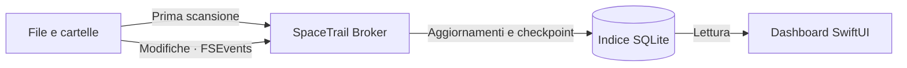

<div align="center">
  
  <h1>SpaceTrail</h1>
  <p><strong>Scopri cosa occupa spazio sul tuo Mac.</strong></p>
  <p>Esplora file, cartelle e cronologia dello spazio da un indice aggiornato in background.</p>
  <p><code>macOS 14+</code> · <code>Swift 6</code> · <code>SwiftUI</code> · <code>SQLite</code></p>
  <p><a href="#avvio-rapido">Avvio rapido</a> · <a href="#cosa-puoi-fare">Funzioni</a> · <a href="#architettura">Architettura</a></p>
</div>

## Cosa puoi fare

| Vista | Cosa mostra |
| --- | --- |
| **File** | Tutti i file indicizzati, ordinabili per spazio su disco, nome, dimensione logica o modifica. |
| **Cartelle** | Il contenuto di ogni cartella con il suo peso e quello delle sottocartelle. |
| **Cerca** | File e cartelle per nome o estensione, con filtri, tolleranza ai piccoli refusi e anteprime. |
| **Mappa** | Una mappa interattiva dello spazio occupato. I toni caldi evidenziano le voci pesanti e i riquadri grandi mostrano le sottocartelle principali. |
| **Spazio** | Capacità del disco, storico e classifica delle cartelle più pesanti. |

File, Cartelle e Cerca offrono viste elenco, compatta e griglia. Il menu contestuale della Mappa apre una cartella nel Finder e consente di spostare nel Cestino gli elementi personali idonei. L’eliminazione definitiva di file e collegamenti richiede conferma. SpaceTrail verifica l’identità degli elementi e protegge i percorsi di sistema, le cartelle standard e i pacchetti delle app.

<details>
<summary>Scorciatoie e anteprime</summary>

| Scorciatoia | Azione |
| --- | --- |
| **⌘F** | Apre Cerca. Premi **Invio** per avviare la ricerca. |
| **Spazio** | Apre Quick Look sul file selezionato. |
| **⌘[** / **⌘]** | Indietro e avanti nella cronologia, come le frecce nella barra e i tasti laterali del mouse. |
| **⌘↑** | Risale alla cartella superiore. |
| **⌘ clic** / **⇧ clic** | Aggiunge una voce o un intervallo alla selezione. |

Le anteprime includono immagini, documenti, fotogrammi di video MP4 e MOV e copertine audio incorporate. Se una cartella personale è protetta, **Consenti anteprime…** apre il selettore di macOS per abilitarle durante la sessione.

</details>

## Avvio rapido

Serve un Mac con **macOS 14 o successivo** e **Swift 6** tramite Xcode 16 o un toolchain compatibile. Compila e avvia SpaceTrail dalla radice del repository.

```sh
./Scripts/build-app.sh
open dist/SpaceTrail.app
```

Al primo avvio scegli l’accesso al disco. La modalità limitata indicizza i percorsi accessibili. Per includere le cartelle protette supportate, segui la configurazione di **Accesso completo al disco** per il broker. Dopo la prima indicizzazione, il broker aggiorna l’indice anche con l’app chiusa se macOS ha autorizzato l’elemento in background.

Lo script produce una build locale con firma ad hoc. Per usare un’identità di firma esistente, imposta `SPACETRAIL_SIGN_IDENTITY` prima di compilare. macOS può richiedere di riconfermare l’accesso dopo una nuova firma ad hoc.

## Architettura



- **Scansione riprendibile.** Il broker salva indice e checkpoint a blocchi. Gli eventi aggiornano i percorsi coinvolti e le verifiche periodiche controllano le cartelle a rotazione.
- **Ricerca locale.** L’indice per nome alimenta i risultati paginati e il broker salva le misure dello spazio in background. L’app può consultare l’ultimo indice disponibile durante una ripresa.
- **Misure APFS.** La dimensione logica è la lunghezza dei file. **Su disco** mostra l’allocazione indicizzata o una stima per la cartella, tenendo conto di link fisici e cloni APFS integrali. **≈** indica una stima e **≥** un minimo misurabile. I blocchi condivisi e gli snapshot incidono sullo spazio liberato.
- **Dati locali.** L’indice e lo storico risiedono in `~/Library/Application Support/SpaceTrail`. L’app indicizza il disco di avvio. L’accesso alle cartelle protette dipende dalle autorizzazioni riconosciute da macOS.

## Verifiche

Con Python 3 installato, esegui la suite del broker dopo aver compilato:

```sh
python3 Scripts/test-broker.py
```

La suite usa directory temporanee e verifica scansione, ricerca, FSEvents, ripresa, migrazione dell’indice e contabilizzazione dei cloni APFS.
