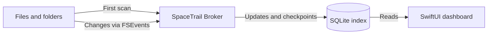

<div align="center">
  
  <h1>SpaceTrail</h1>
  <p><strong>See what takes up space on your Mac.</strong></p>
  <p>Browse files, folders, and storage history from an index that updates in the background.</p>
  <p><code>macOS 14+</code> · <code>Swift 6</code> · <code>SwiftUI</code> · <code>SQLite</code></p>
  <p><a href="#quick-start">Quick Start</a> · <a href="#features">Features</a> · <a href="#architecture">Architecture</a></p>
</div>

## Features

| View | What you can do |
| --- | --- |
| **Files** | Sort indexed files by disk usage, name, logical size, or modification date. |
| **Folders** | Browse folders and see how much space their contents and subfolders use. |
| **Search** | Find files and folders by name or extension, with filters, typo tolerance, and previews. |
| **Map** | Explore disk usage in an interactive treemap. Warm colors highlight larger items, and large tiles show the main subfolders. |
| **Storage** | See disk capacity, usage history, and the largest folders. |

Files, Folders, and Search offer list, compact, and grid views. From the Map context menu, you can open a folder in Finder or move eligible personal items to the Trash. SpaceTrail verifies an item’s identity before removing it and asks for confirmation before deleting files or links permanently. System paths, standard home folders, and app bundles are protected.

<details>
<summary>Keyboard shortcuts and previews</summary>

| Shortcut | Action |
| --- | --- |
| **⌘F** | Open Search. Press **Return** to run the search. |
| **Space** | Open Quick Look for the selected file. |
| **⌘[** / **⌘]** | Go back or forward, like the toolbar arrows and mouse side buttons. |
| **⌘↑** | Go to the parent folder. |
| **⌘-click** / **⇧-click** | Add an item or a range to the selection. |

Previews include images, documents, MP4 and MOV video frames, and embedded audio artwork. For a protected personal folder, **Allow Previews…** opens the macOS folder picker so you can enable previews for the current session.

</details>

## Quick Start

You’ll need **macOS 14 or later** and **Swift 6** from Xcode 16 or a compatible toolchain. Build and launch SpaceTrail from the repository root.

```sh
./Scripts/build-app.sh
open dist/SpaceTrail.app
```

Choose a disk access mode on first launch. **Limited Access** indexes accessible locations. To include supported protected folders, follow the **Full Disk Access** setup for SpaceTrail Broker. After the first scan, the broker keeps the index current while the app is closed if macOS permits it to run in the background.

The build script signs the local app ad hoc. Set `SPACETRAIL_SIGN_IDENTITY` before building to use an existing signing identity. macOS may ask you to confirm access again after an ad hoc rebuild.

## Architecture



- **Resumable scans.** The broker saves index changes and checkpoints in batches. It uses FSEvents to update affected paths and checks folders on a rotating schedule.
- **Local search.** The filename index powers paginated results. The broker measures disk usage in the background. You can browse the last saved index while updates resume.
- **APFS measurements.** Logical size is the length of a file. **On Disk** shows its allocated size or the estimated size of a folder, accounting for hard links and whole-file APFS clones. **≈** marks an estimate and **≥** marks a measured minimum. Shared blocks and snapshots affect how much space a deletion frees.
- **Local data.** SpaceTrail indexes the startup disk and stores the index and history in `~/Library/Application Support/SpaceTrail`. macOS permissions determine which protected folders it can access.

## Tests

With Python 3 installed, run the broker suite after building the app.

```sh
python3 Scripts/test-broker.py
```

The suite uses temporary directories to verify scanning, search, FSEvents updates, scan resumption, index migration, and APFS clone accounting.
