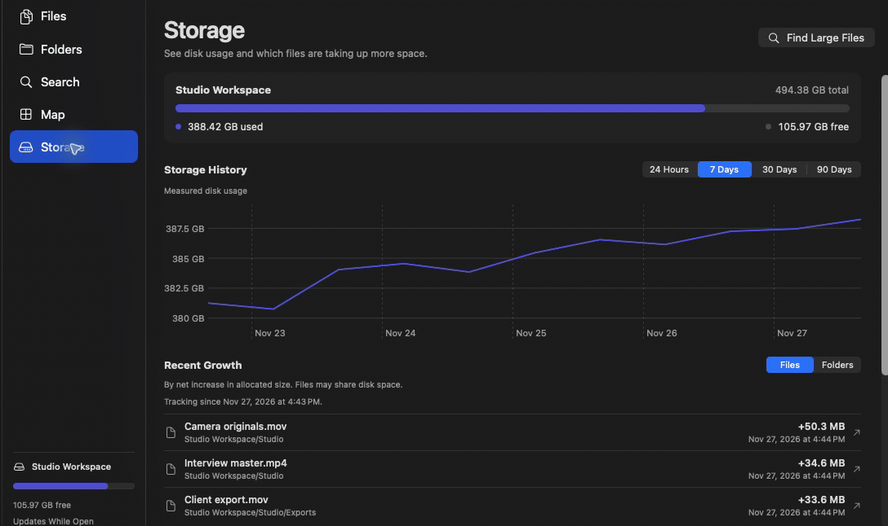
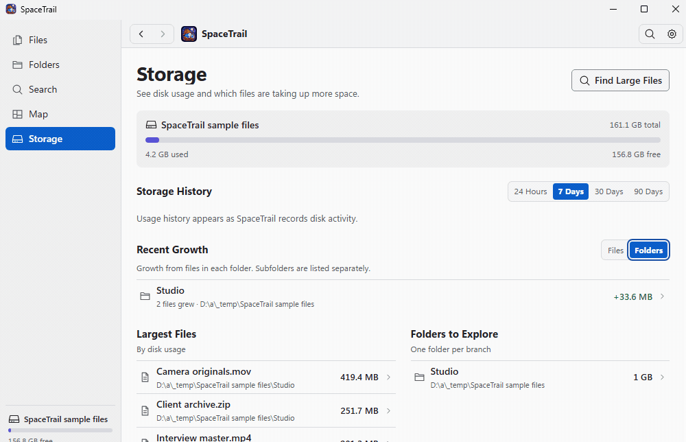
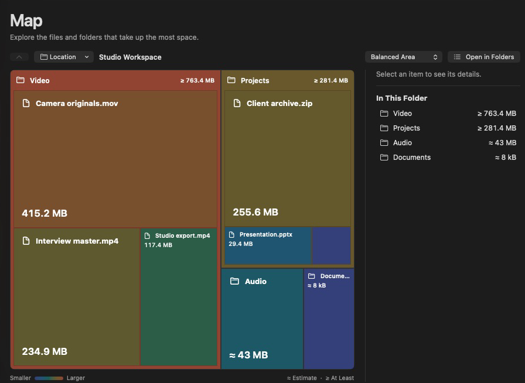
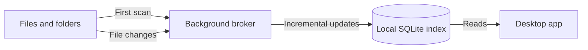

<div align="center">
  
  <h1>SpaceTrail</h1>
  <p><strong>See what takes up space the moment you open SpaceTrail.</strong></p>
  <p>Find large files, explore folders, and see what grew. A local index stays current in the background.</p>
  <p><code>macOS 14+</code> · <code>Windows 11</code></p>
  <p><a href="https://github.com/saropuglisi/SpaceTrail/releases/tag/windows-v0.4.0">Download for Windows</a> · <a href="#macos">Build for macOS</a> · <a href="#see-it-in-action">Watch the demos</a></p>
</div>

## See It in Action

Open **Storage** to see recent growth. **Find Large Files** opens Files with a 100 MB minimum, and Search lets you combine size, format, and name.



<details>
<summary>Watch the Windows walkthrough</summary>



</details>

The demos use sample files and storage history.

## Features

| View | What you can do |
| --- | --- |
| **Files** | Filter by format and minimum space used on disk, then sort by disk usage, name, logical size, or modification date. |
| **Folders** | Browse folders and see how much space their contents and subfolders use. |
| **Search** | Find indexed files and folders by name. Combine a file type, a minimum size, and a name for more focused results. |
| **Map** | Explore disk usage in an interactive treemap. Open a folder to see which items account for its size. |
| **Storage** | See disk capacity, usage history, and which files have added the most space recently. |

The size filter uses **On Disk**. A sparse file can have a large logical size and use very little storage.

<details>
<summary>See the macOS disk map</summary>



</details>

On macOS, Files, Folders, and Search offer list, compact, and grid views. Search supports custom extensions and similar names. The Map context menu can show a folder in Finder or move eligible personal items to the Trash. SpaceTrail verifies an item’s identity before removal and asks for confirmation before permanent deletion. System paths, standard home folders, and app bundles are protected.

<details>
<summary>macOS shortcuts and previews</summary>

| Shortcut | Action |
| --- | --- |
| **⌘F** | Open Search. Press **Return** to run the search. |
| **Space** | Open Quick Look for the selected file. |
| **⌘[** / **⌘]** | Go back or forward, like the toolbar arrows and mouse side buttons. |
| **⌘↑** | Go to the parent folder. |
| **⌘-click** / **⇧-click** | Add an item or a range to the selection. |

Previews include images, documents, embedded EPUB covers, MP4 and MOV video frames, and embedded audio artwork. Use **Allow Previews…** in Search to select a folder shown in the results. Access includes its subfolders and is saved across launches when macOS permits it. You can manage your selection in Settings.

The window also handles side buttons mapped to **⌘[** and **⌘]** by a mouse utility.

</details>

## Quick Start

### Windows

Run the installer for your Windows 11 PC. Setup updates an existing installation and preserves its index and sign-in choice. [Download for Intel or AMD](https://github.com/saropuglisi/SpaceTrail/releases/download/windows-v0.4.0/SpaceTrail-Setup-x64.exe) · [Download for Arm](https://github.com/saropuglisi/SpaceTrail/releases/download/windows-v0.4.0/SpaceTrail-Setup-arm64.exe) · [Windows guide](windows/README.md)

SpaceTrail indexes accessible fixed drives and shows their status during the first scan. Choose **Open at Sign-in** during setup to open the window automatically, or change the choice later in **Settings → Startup**.

### macOS

You’ll need **macOS 14 or later** and **Swift 6** from Xcode 16 or a compatible toolchain. Build and launch SpaceTrail from the repository root.

```sh
./Scripts/build-app.sh
open dist/SpaceTrail.app
```

Choose a disk access mode on first launch. **Limited Access** indexes accessible locations. To include supported protected folders, follow the **Full Disk Access** setup for SpaceTrail Broker. After the first scan, the broker keeps the index current while the app is closed if macOS permits it to run in the background.

Choose **Open at Login** during setup to open the SpaceTrail window when you log in. You can change your choice under **Settings → Startup**. If macOS requires approval, use **Open Login Items** to finish setup.

The build script signs the local app ad hoc. Set `SPACETRAIL_SIGN_IDENTITY` before building to use an existing signing identity. macOS may ask you to confirm access again after an ad hoc rebuild.

If macOS refuses to start the background helper from a build folder inside Documents, copy `SpaceTrail.app` to `~/Applications` and open it there.

## Architecture



- **macOS** uses Swift and SwiftUI with FSEvents. The broker stores checkpoints while scanning the startup disk, measures APFS folder usage, and checks folders on a rotating schedule.
- **Windows** uses Rust and WebView2. The broker observes directory changes, updates each drive’s index, and reconciles folders in batches after downtime.
- **Both** store file metadata in SQLite, reuse directory references, and query the saved index while the broker records changes. Recent File Growth ranks files still present by net allocation added in the selected period.

On macOS the index lives in `~/Library/Application Support/SpaceTrail`. On Windows it lives in `%LOCALAPPDATA%\SpaceTrail`. The **≈** marker indicates an estimate and **≥** indicates a measured minimum. Shared storage affects how much space a deletion frees.

## Tests

After building for macOS, run the broker suite with Python 3.

```sh
python3 Scripts/test-broker.py
```

It checks scanning, search, FSEvents updates, scan resumption, index migration, and APFS clone accounting using temporary directories.

Run the Rust index and watcher tests with `cargo test --locked --manifest-path windows/Cargo.toml`. The installer workflow tests fresh setup, in-place updates, sign-in preferences, and desktop filtering on x64 and Arm64. [Windows build and test workflow](.github/workflows/windows.yml)
